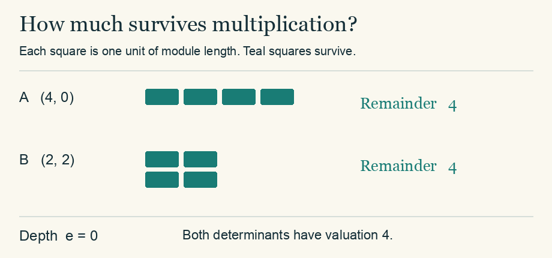

# Understanding and shortening Alpöge’s proof of the Riemann Hypothesis

This independent RQM Technologies project has two aims. We teach the ideas behind Levent Alpöge’s proof, developed with Claude, and test whether individual steps can be shortened while preserving the theorem they prove.

## Learn the proof

The Riemann Hypothesis says that every nontrivial zero of the Riemann zeta function has real part $1/2$. Why should a zero tell us anything about primes? In an explicit formula for counting prime powers, a zero with real part $\beta$ contributes an oscillation whose size scales as $x^\beta$. The location of the zeros therefore controls how far the count can stray from its main term. [Illustrated introduction to primes and zeros](docs/reading-the-proof.md)

1. **Follow the arithmetic question.** At $x=10$, the prime powers contributing to the weighted count are $2,3,4,5,7,8,9$. Each power of two contributes $\log 2$, so the count is $3\log 2+2\log 3+\log 5+\log 7$. Alpöge studies a smoothed sum of these prime-power weights. Smoothing changes how much each term contributes according to its position in the sum. [Alpöge’s account of the argument](https://alpo.ge/remark.pdf)
2. **See where theta lifts enter.** A theta lift transfers a mathematical object called an automorphic form from one group to another. Alpöge describes chaining lifts to build up multiplicity. Each lift also incurs an arithmetic cost. Bounding divisibility and the indices of lattices helps control that cost. For a detailed walk through the classical zeta case, see [Michael Rubinstein’s working exposition](https://www.math.uwaterloo.ca/~mrubinst/alpoge_claude_grh/).
3. **Work through a step by hand.** Two lattices can have the same index and behave differently under multiplication by a prime. The worked example calculates exactly how much discrepancy survives. This is the quantity our compression experiment passes to the next step. [Local length example](docs/reading-the-proof.md#what-the-determinant-loses)

**Verification of the original proof.** On November 21, 2026, the Lean FRO and the Mathlib Initiative certified the classical RH statement and Alpöge’s formal proof. They compared the conclusion against Mathlib’s established definition and checked the proof with independently implemented checkers. [Joint statement](https://leanprover-community.github.io/blog/posts/riemann-hypothesis/) · [Andrew Sutherland’s verification records](https://math.mit.edu/~drew/grh/)

## Shorten a step

Our first experiment replaces a family of local estimates with one integer at each depth. It is distributed as a patch against a [pinned upstream revision](https://github.com/leanprover-community/riemann-hypothesis/tree/712a6aef8fe265fb6f3a5fa1f3101a017aec8fe9). The local audit records 30 fewer reachable project declarations at one row entry point. A shorter proof of the complete theorem remains a research goal. [Audit and replay instructions](direct-projector-replay.md)

### How the local estimate works

At a finite place, let $Q=M/\Theta$ measure the difference between the ambient lattice and the theta lattice. After multiplying by a uniformizer $\pi$ to depth $e$, the surviving discrepancy has length $R_e(Q)=\operatorname{length}(\pi^e Q)$.

For a row quotient $B$, let $\delta$ be the number of cosets and $u$ the valuation of the subgroup order. The projector maps give the following bound.

$$\boxed{\displaystyle R_{e+u}(B)\;\le\;\frac{R_e(Q)}{\delta}.}$$

The transfer into one coset followed by projection from another is zero. On the matching coset the composite multiplies by the subgroup order. Together the maps account for $\delta$ copies of the surviving row inside the image of the ambient quotient. This skips the intermediate estimate over every subspace. Lean checks the inequality for quaternion-linear transfers by measuring length over the central ring. [Projector proof and replay](direct-projector-replay.md) · [Quaternion-linear theorem](DirectProjectorAudit.lean)

For example, with three cosets and $R_e(Q)=7$, the surviving length of one row is at most two at depth $e+u$. This is where the factor of three enters the proof. It comes from the three copies fitting inside an image of length at most seven.

## What quaternions contribute

Quaternions compress the bookkeeping at conjugate places. For an invertible matrix $A$ over the quadratic subfield, its quaternionic reduced norm is $\det(A)\overline{\det(A)}$. One norm packages both determinant contributions. The scalar remainder retains the depth information a determinant alone loses. The local proof uses orthogonality over the central ring. Exhibiting a quaternion action on the specific arithmetic rows would give a stronger quaternionic interpretation. [Worked example with animation](docs/reading-the-proof.md#what-quaternions-combine)

## How far the fork reaches

**Checked locally.** The scalar estimate passes through completion and ramification. The two transported remainder functions can be installed in the row object and passed to `paired_of_completed` on its original window. The original row entry point reaches **518** project declarations under the audit’s namespace filter. The direct row reaches **488**. It drops 31 declarations, including `threeForms_of`, and adds one. These counts cover the local row proof. [Reproduce the dependency count](direct-projector-replay.md)

**Open globally.** Both arithmetic branches specify their allowance by the same function `rLa`. At the terminal index it reduces to the base-index term plus the Gauss term. The concrete two-run family still needs a checked Lean connection from those allowances to the row inputs. A replay of the modified `Main` and an end-to-end proof-length or runtime saving remain open. [Exact witnesses and remaining obligations](docs/theta-witnesses.md) · [Reproduce the transport checks](docs/scalar-transport.md)

**Two-run test.** Lean accepts the depth bound when the existing arithmetic runs supply their subspace estimates. At the theorem that consumes their output, the depth route reaches 527 project declarations and 708,156 expression nodes. The pinned upstream route reaches 508 and 677,821. Reconstructing the depth count at this point costs more than it saves. [Experiment, baselines and replay](docs/theta-witnesses.md#testing-the-existing-two-run-output)

## Earlier RQM research

The research index preserves the exploratory quaternionic models, numerical tests, and obstructions that preceded this project’s study of Alpöge’s proof. [Browse the research index](RESEARCH-INDEX.md)
