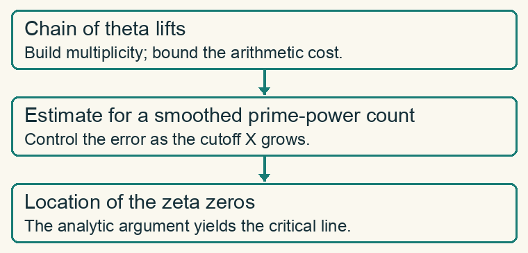

# A visual guide to Alpöge’s proof of the Riemann Hypothesis

**What can the location of a zero tell us about the primes?** This illustrated guide follows the classical Riemann Hypothesis through Levent Alpöge’s proof, developed with Claude. RQM Technologies created the lessons and figures for undergraduate readers familiar with complex numbers and linear algebra.

Read the map **from the bottom up** to understand the problem. Then follow the arrows down to see how the proof answers it. Each arrow summarizes a substantial part of the argument. [Alpöge’s four-page account](https://alpo.ge/remark.pdf)

1. **[How can a zero affect a prime count?](docs/zeros-and-primes.md)** Move a hypothetical zero sideways in the critical strip and watch what happens to its oscillation.
2. **[What does the proof actually count?](docs/smoothed-prime-powers.md)** Calculate the contribution of every prime power through 10 and see why powers of two receive different weights after smoothing.
3. **[Why repeat a theta lift?](docs/chain-of-theta-lifts.md)** Follow one form through a chain of groups and see why the proof needs both multiplicity and a bound on its arithmetic cost.
4. **[Where does divisibility enter the lifts?](docs/divisibility-in-theta-lifts.md)** Apply a sum-and-difference rule twice and see why a factor of two is guaranteed for every integer input.
5. **[When is the divisibility gain enough?](docs/divisibility-size-and-level.md)** Put the possible multiples on a number line and see how a finer level can let a nonzero value back in.

## Read the original proof

The upstream Lean theorem is named `riemannHypothesis`. The joint verification statement explains how the checkers tested the formal argument and compared its conclusion with the classical statement. [Pinned Lean theorem](https://github.com/leanprover-community/riemann-hypothesis/blob/712a6aef8fe265fb6f3a5fa1f3101a017aec8fe9/src/Main.lean#L4) · [Lean FRO and Mathlib Initiative verification](https://leanprover-community.github.io/blog/posts/riemann-hypothesis/)

[Research archive](RESEARCH-INDEX.md)
