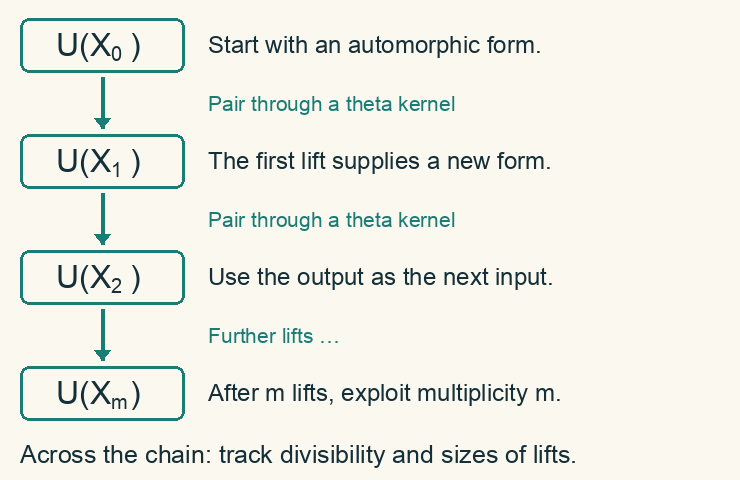

# Why repeat a theta lift?

An automorphic form is a function with symmetry under an arithmetic group, subject to additional regularity and growth conditions. A theta lift uses a function of two variables, the **theta kernel**, to turn a form on one group into a form on another. Picture holding the second variable fixed while pairing the kernel with the input over the first group. As the second variable moves, the pairings trace out the new form.

Here $U(X_j)$ is the unitary group preserving the Hermitian form on a space $X_j$. At each arrow, the output of the previous lift becomes the next input. Alpöge describes a chain of length $m$ on the scale of $\sqrt X$ for a sum with cutoff $X$. [Alpöge’s account, opening discussion and items 8–10](https://alpo.ge/remark.pdf)

### What does multiplicity buy?

For an undergraduate analogy, suppose a polynomial is divisible by $(t-a)^m$. A single point $a$ then accounts for at least $m$ degrees of the polynomial. Multiplicity lets one location impose a stronger constraint. In the proof, the repeated quantity comes from the structure of the lifted automorphic representations. The polynomial example illustrates why multiplicity matters; $m$ counts lifts in the arithmetic construction.

### Why the arrows alone are insufficient

The argument needs an arithmetic comparison. On one side, the iterated construction supplies multiplicity and a lower bound on divisibility. On the other, estimates control the norms of the lifted forms and the cost of the levels at which they are defined. A norm measures size; a level specifies arithmetic symmetry conditions. Both sides depend on how far the chain runs. The proof has to control those costs tightly enough for the multiplicity gain to feed the prime-sum estimate. The previous lesson explains how a sufficiently strong estimate on that sum constrains zeros. [Alpöge’s account, items 8–16](https://alpo.ge/remark.pdf#page=4) · [Analytic link to the zeros](smoothed-prime-powers.md)

**Read the figure.** Suppose you can construct one more lift. What extra information would you need before claiming a better prime-sum estimate? You would need quantitative control of the new divisibility and the accompanying size and level costs. The existence of another form gives you an object on which to make that comparison.

[Next: where divisibility enters the lifts](divisibility-in-theta-lifts.md) · [Return to the proof map](../README.md) · [Read the formal conclusion in Lean](https://github.com/leanprover-community/riemann-hypothesis/blob/712a6aef8fe265fb6f3a5fa1f3101a017aec8fe9/src/Main.lean#L4)
