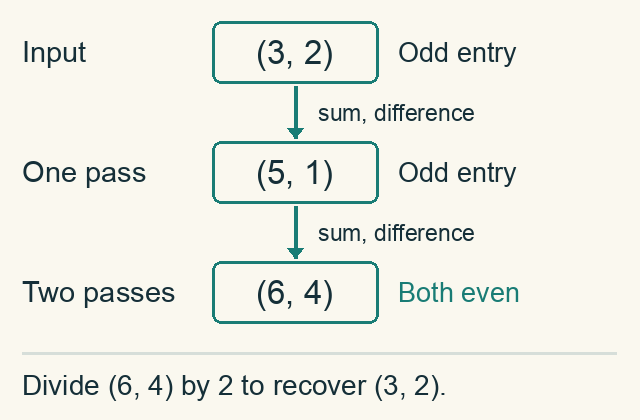

# Where does divisibility enter the theta lifts?

[Lesson 3](chain-of-theta-lifts.md) followed a form through a chain of unitary groups. At the far end of that chain, Alpöge needs an arithmetic fact about the **output of the iterated lift**. In items 8–10 of his account, he describes obtaining multiplicity from the chain, estimating norms and levels, and proving a lower bound on divisibility. A lower bound tells you how much division the arithmetic data can absorb while staying integral. Here is what that means in a two-coordinate model. [Alpöge’s account, items 8–10 and 14](https://alpo.ge/remark.pdf#page=4)

## Two passes with pencil and paper

Start with any pair of integers. One pass of our model replaces the pair by its **sum and difference**. For example, start at $(3,2)$.

The first pass gives $(3+2,3-2)=(5,1)$. Dividing both entries by two here would give fractions. The second pass gives $(5+1,5-1)=(6,4)$. This time both entries are divisible by two. Could that be luck?

Write the starting pair as $(a,b)$. After one pass the entries are $a+b$ and $a-b$. After two passes they are

$$\big((a+b)+(a-b),\ (a+b)-(a-b)\big)=(2a,2b).$$

In the first coordinate the two copies of $b$ cancel; in the second the two copies of $a$ cancel. **Every** two-pass output lies in the even lattice $2\mathbb Z^2$, the grid of points with both coordinates even. That is a divisibility lower bound. The input $(3,2)$ also shows its limit: the first output coordinate after two passes is 6, so a common factor of four cannot be guaranteed.

## What does this buy?

Suppose a calculation asks you to divide the final output by two. The identity above lets you do that for every integer input and recover an integer pair. Divisibility answers a different question from ordinary size. The pairs $(6,4)$ and $(7,1)$ both have coordinate sum 10, yet only the first survives division by two inside the integer lattice.

In Alpöge’s argument the maps are theta lifts, and the lower bound for the iterated lift requires arithmetic estimates. The sum-and-difference rule is a teaching model: it isolates why proving a common factor provides information beyond counting the lifts or estimating their size. Its factor of two comes from the displayed identity. The actual proof must establish its own divisibility and compare it with the cost of the lifts. [Alpöge’s account, items 9–10 and 14–15](https://alpo.ge/remark.pdf#page=4)

**Try it.** After four passes, what common factor is guaranteed? Can you guarantee eight?

Check your reasoning

Two passes double both coordinates. Applying that identity twice gives $(4a,4b)$, so four is guaranteed. Starting from $(3,2)$ gives $(12,8)$, and 12 is not divisible by eight.

[Previous: why repeat a theta lift?](chain-of-theta-lifts.md) · [Next: weigh divisibility against size and level](divisibility-size-and-level.md) · [Return to the proof map](../README.md)
