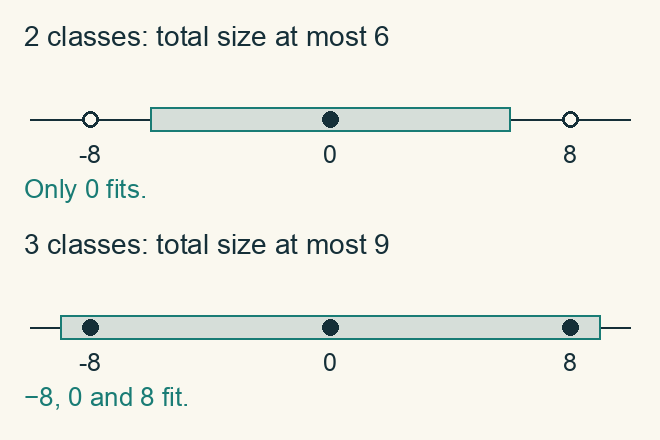

# When is the divisibility gain enough?

[Lesson 4](divisibility-in-theta-lifts.md) showed how a common factor can emerge after several steps. Now suppose you know that **8 divides an integer**. To learn which integer you have, ask a second question: *how large could it be?* An integer of absolute value at most 6 has only one chance to be a multiple of 8. Raise the bound to 9, and two more possibilities appear.

## A model you can calculate by hand

Imagine sorting contributions into residue classes modulo $N$. Add up the contributions in each class, then add those class totals to get an integer $T$. We will call $N$ the **level** of this model. At level 2 there are two classes (even and odd); at level 3 there are three (remainders 0, 1, and 2).

Suppose two estimates have already been proved for each level we consider. First, $8\mid T$: the **total** is divisible by 8. Second, each class total has absolute value at most 3. The triangle inequality then gives $|T|\le 3N$. The 3 measures size per class; the factor $N$ is what it costs this estimate to sum across the level.

**Read the figure.** The dots come from divisibility. The shaded interval comes from size and level. A value of $T$ must satisfy both conditions.

| Level | Size bound | What can you conclude? |
|---|---|---|
| $N=2$ | $\lvert T\rvert\le 2\cdot3=6$ | The nearest nonzero multiples are $-8$ and $8$. Both lie outside the interval, so $T=0$. |
| $N=3$ | $\lvert T\rvert\le 3\cdot3=9$ | Zero is still possible, and so is 8. Class totals $3,3,2$ actually realize it. |

The strict inequality matters. If the guaranteed divisor is $D>0$ and the size bound per class is $B$, then $NB<D$ forces $T=0$. At $NB=D$, a nonzero multiple can sit exactly on the endpoint.

## What this comparison does in the theta-lift argument

In Alpöge’s account, the iterated theta lift supplies multiplicity. To turn that gain into an estimate, the argument also needs a lower bound on divisibility of the iterated lift and quantitative control of its norms and level. A norm measures size. The level specifies the arithmetic symmetry conditions on the forms being compared. Alpöge describes cancellation of terms of order $m$ in this accounting, where $m$ is the chain length. This is why simply counting the lifts leaves an essential question open: how much of the gain survives after the costs are included? [Alpöge’s account, items 8–10 and 14–15](https://alpo.ge/remark.pdf#page=4)

The example makes the comparison visible by using ordinary integers and a level cost you can derive by hand. Its factor $N$ comes specifically from summing $N$ bounded class totals. In the proof, the cost of the lifts requires its own estimates, and the goal is control of the [smoothed prime-power sum](smoothed-prime-powers.md). Forcing $T=0$ is the conclusion of the classroom example.

**Try it.** Keep three classes and the size bound of 3 per class. Suppose a stronger divisibility argument gives $16\mid T$. What follows? Now keep the divisor 16 and allow each class total to have absolute value at most 6. Can you exhibit a nonzero total?

Check your answer

With the original size estimate, $|T|\le9<16$, so $T=0$. With the larger size estimate, $|T|\le18$. The class totals $6,6,4$ give $T=16$. A stronger divisor buys room only to the extent that the combined cost stays below it.

[Previous: where divisibility enters the lifts](divisibility-in-theta-lifts.md) · [Return to the proof map](../README.md)
