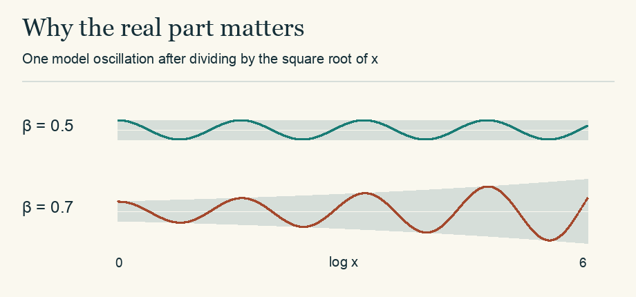
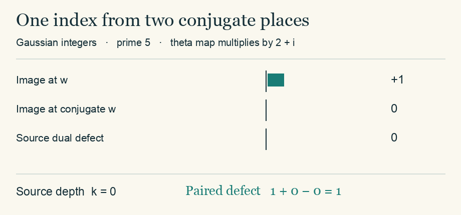

# From primes to a local length

## Why study the zeros?

Counting primes looks irregular. A convenient way to count them is to give each prime power a weight. Write $\psi(x)=\sum_{p^k\le x}\log p$, with $k\ge1$. Its main term is $x$. In the explicit formula for $\psi$, a nontrivial zero $\rho=\beta+i\gamma$ contributes an oscillation proportional to $x^\rho/\rho$. At fixed $\rho$ its magnitude scales as $x^\beta$. This explains why the real part of a zero matters for prime counts. RH asserts that every such $\beta$ equals $1/2$. In the classical estimate this gives $\psi(x)=x+O(\sqrt{x}\log^2 x)$. The sum over zeros requires a limiting prescription. [Clay Mathematics Institute’s problem description](https://www.claymath.org/wp-content/uploads/2022/05/riemann.pdf)

The figure plots $x^{\beta-1/2}\cos(4\log x)$ against $\log x$ on the same vertical scale in both panels. Dividing by $\sqrt{x}$ makes the first envelope constant. The second grows as $x^{0.2}$. Both frequencies are illustrative. An actual explicit-formula term also includes the constant amplitude and phase from $1/\rho$, and the prime-counting error combines contributions from many zeros.

## What is the lift doing?

A theta lift transfers an automorphic form from one group to another through a theta kernel. Schematically one pairs the input $f(g)$ with $\theta(g,h)$ and integrates in $g$. What remains is a form in the variable $h$. Which groups, which kernel, and which normalizations one chooses are part of the construction. The schematic integral alone gives no bound on denominators.

In the part of the submitted argument studied here, the quantitative question concerns two lattices. Think of $M$ as the ambient integral forms and $\Theta\subseteq M$ as the lattice supplied by the construction. At one finite place, multiplication by a uniformizer $\pi$ is one step of divisibility. An element of $M/\Theta$ measures a failure to belong to $\Theta$. If $\pi^e$ kills its class, that failure disappears at depth $e$. The passage below concerns this local step inside the arithmetic argument. [Pinned geometric local estimate](https://github.com/leanprover-community/riemann-hypothesis/blob/712a6aef8fe265fb6f3a5fa1f3101a017aec8fe9/src/Formalism/SharpRestriction/GenusPolyhedralBounds/RelativeIndexClassSets/JWMggWMem.lean)

## What the determinant loses

Over a discrete valuation ring, write the finite quotient as a sum of cyclic modules of lengths $a_i$. A factor of length $a_i$ has $\max(a_i-e,0)$ layers left after multiplication by $\pi^e$. Thus one integer measures everything left at this depth,

$$R_e=\operatorname{length}(\pi^e(M/\Theta))=\sum_i\max(a_i-e,0).$$

| Depth $e$ | 0 | 1 | 2 | 3 | 4 |
| --- | ---: | ---: | ---: | ---: | ---: |
| $M/\Theta$ with exponents $(4,0)$ | 4 | 3 | 2 | 1 | 0 |
| $M/\Theta$ with exponents $(2,2)$ | 4 | 2 | 0 | 0 | 0 |

In either example the determinant has valuation four. In the first, one direction accounts for the entire defect. Any estimate for a projected row has to allow for such concentration. The [animated columns](figures/scalar-depth.gif) show exactly what is left to bound.

## What quaternions combine

Let $K=\mathbb Q(i)$, let $\pi=2+i$, and factor $5=\pi\bar\pi$. Its two prime ideals define conjugate places $w$ and $\bar w$. Take the ambient lattice $M=\mathbb Z[i]$, source lattice $T=\pi^k M$, and the map $\theta(x)=\pi x$. This multiplication illustrates an invertible block. It is a teaching example of the index calculation.

At $w$, the image $\theta T=\pi^{k+1}M$ has index length $k+1$. At $\bar w$, $\pi$ is a unit, so the index there is zero. For the Hermitian form $x\bar y$, the dual of $T$ is $\bar\pi^{-k}M$. Its signed contribution at $w$ is $-k$. Adding gives one for every $k$. Independently, transporting the form by $\theta^{-1}$ divides its Gram scalar by $\pi\bar\pi=5$, whose valuation at $w$ is one. The two ways of computing the defect agree.

The quaternion algebra $K\oplus KJ$, with $J^2=-1$ and $Jz=\bar zJ$, represents the conjugation exchanging those two places. For $z\in K$ its reduced norm is $z\bar z$. For a matrix $A$ over $K$ the corresponding reduced norm is $\det(A)\overline{\det(A)}$. This packages the conjugate determinant factors in one expression. The column example above explains why that identity alone leaves the row estimate open. [Derivation and scope](../quaternionic-descent.md)

## Where a step could disappear

For a row quotient $B$ and an ambient quotient $Q$, the local projector calculation gives $\delta R_{e+u}(B)\le R_e(Q)$, where $\delta$ counts the cosets and $u$ is the valuation of the subgroup order. If the geometric construction gives $R_e(Q)\le r$, the row receives an allowance of $r/\delta$ at depth $e+u$. That implication is the local shortcut. It also holds over the central coefficient ring, so the current check establishes no saving unique to quaternions.

A global proof needs the same $r$ that was budgeted geometrically at each place, through completion, extension of fields and the selection between two arithmetic runs. Two individually small budget totals can come from different functions of the place. Substituting one for the other requires a pointwise argument. The [Lean replay record](../direct-projector-replay.md) and [transport audit](scalar-transport.md) identify the precise boundary of the experiment.
