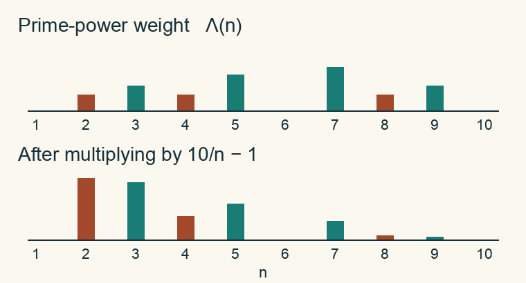

# What does the proof actually count?

The von Mangoldt function gives $n=p^k$ the weight $\Lambda(n)=\log p$ for every prime $p$ and integer $k\ge1$. All other positive integers receive zero. Alpöge describes a smoothed count that multiplies each weight by a second factor depending on its position below the cutoff $X$. Call its uncentered sum

$$S(X)=\sum_{n\le X}\Lambda(n)\left(\frac Xn-1\right).$$

Orange marks powers of two in both panels. The horizontal axis includes 6 and 10 so you can see where a product of distinct primes contributes zero.

### Work the example at X = 10

| Prime power $n$ | $\Lambda(n)$ | Multiplier $10/n-1$ | Contribution to $S(10)$ |
|---:|---:|---:|---:|
| 2 | $\log 2$ | $4$ | $4\log 2$ |
| 3 | $\log 3$ | $7/3$ | $(7/3)\log 3$ |
| 4 | $\log 2$ | $3/2$ | $(3/2)\log 2$ |
| 5 | $\log 5$ | $1$ | $\log 5$ |
| 7 | $\log 7$ | $3/7$ | $(3/7)\log 7$ |
| 8 | $\log 2$ | $1/4$ | $(1/4)\log 2$ |
| 9 | $\log 3$ | $1/9$ | $(1/9)\log 3$ |

Grouping by the underlying prime gives $S(10)=(23/4)\log 2+(22/9)\log 3+\log 5+(3/7)\log 7$.

**Read the figure.** How much more does 2 contribute than 8? They have the same base weight, so the ratio is entirely in the multiplier: $4/(1/4)=16$.

### What estimate would locate the zeros?

Let $\gamma_E$ be Euler’s constant. The centered quantity in Alpöge’s account is $S(X)-X\log X+(1+\gamma_E)X$. A single cutoff illustrates the weights. The proof needs control of this remainder as $X$ grows. [Alpöge’s formula, item 5](https://alpo.ge/remark.pdf#page=3)

There is an analytic reason this helps. For $\operatorname{Re}(s)>1$, integrating the contribution from each $n$ gives

$$\int_1^\infty S(X)X^{-s-1}\,dX=-\frac{\zeta'(s)}{s(s-1)\zeta(s)}.$$

A zeta zero gives the right side a pole. If the centered remainder is $O_\varepsilon(X^{1/2+\varepsilon})$ for every $\varepsilon>0$, its integral is analytic throughout $\operatorname{Re}(s)>1/2$. The two subtracted main terms account for the singularity at 1. That excludes zeros to the right of the critical line, and the zeta functional equation excludes their reflections to the left. This explains why an estimate of square-root strength suffices. [Classical zeta background](https://www.claymath.org/wp-content/uploads/2022/05/riemann.pdf)

[Next: follow the chain of theta lifts](chain-of-theta-lifts.md) · [Proof map](../README.md)
