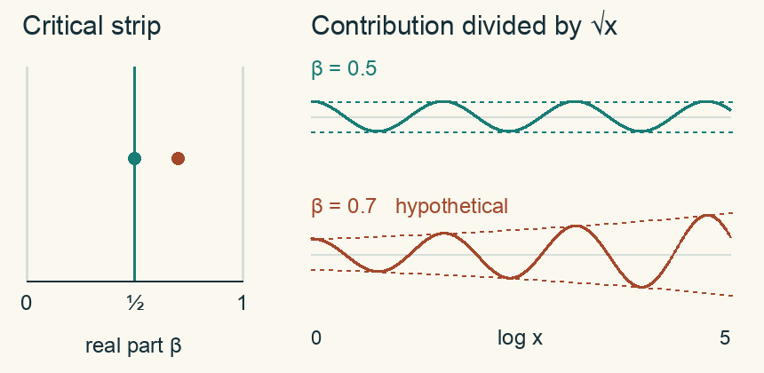

# How can a zero affect a prime count?

Write a zero of the zeta function as $\rho=\beta+i\gamma$. Its horizontal coordinate is $\beta$ and its height is $\gamma$. The nontrivial zeros lie in the **critical strip**, between real parts 0 and 1. RH says they all lie on its middle line, $\beta=1/2$.

The solid waves illustrate $x^{\beta-1/2}\cos(4\log x)$ with a common vertical scale. The dotted curves mark the positive and negative envelopes. Both points use the illustrative height 4; the orange point shows a hypothetical off-line zero.

### Read the wave

The explicit formula for the weighted prime count $\psi(x)=\sum_{p^k\le x}\log p$ has main term $x$. Each conjugate pair of nontrivial zeros contributes $-2\operatorname{Re}(x^\rho/\rho)$, with the full sum interpreted by a limit. To see the shape of one contribution, expand

$$x^\rho=x^\beta\bigl(\cos(\gamma\log x)+i\sin(\gamma\log x)\bigr).$$

The factor $1/\rho$ sets a constant amplitude and phase. The height sets the frequency in $\log x$, and the horizontal coordinate sets the growth rate. Dividing by $\sqrt{x}$ makes that growth especially easy to see. The actual counting error combines all the terms. [Bombieri’s account of the explicit formula](https://www.claymath.org/wp-content/uploads/2022/05/riemann.pdf)

**Read the figure.** If $x$ increases by a factor of 32, what happens to each normalized envelope? The teal envelope stays at 1. The orange envelope doubles because $32^{0.7-0.5}=2$.

[Next: calculate the smoothed prime-power count](smoothed-prime-powers.md) · [Proof map](../README.md)
